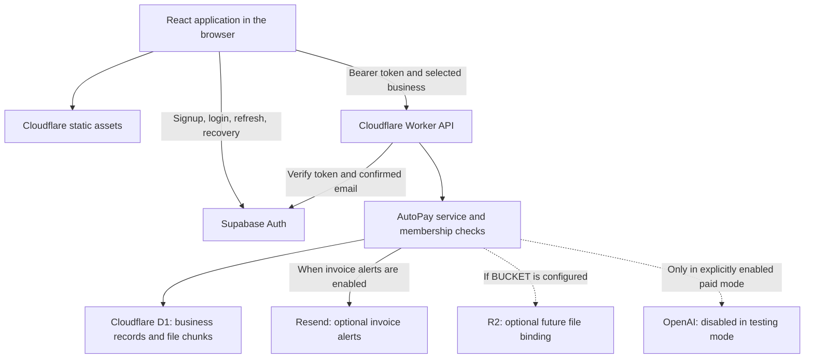

# AutoPay: Complete Project Guide


See the [File-by-file Guide](FILE_GUIDE.md) for the complete tracked-file index and inline-comment conventions.

This guide explains the current application, its source files, data model, request flows, configuration, deployment, tests, and practical limits. It describes the implementation present in this repository since **November 23, 2026**. Configuration examples contain names and placeholders, never private credentials or exported business records.

**Application:** https://autopay.aredthsanchez.workers.dev/  
**Repository:** https://github.com/AredthSanchez/AutoPay  
**Quick start:** [README](../README.md)  
**Migration notes:** [MIGRATION.md](MIGRATION.md)

## Contents

- [Project purpose and current status](#project-purpose-and-current-status)
- [System architecture](#system-architecture)
- [Repository and file map](#repository-and-file-map)
- [Application screens and navigation](#application-screens-and-navigation)
- [Authentication and account lifecycle](#authentication-and-account-lifecycle)
- [Businesses, roles, and invitations](#businesses-roles-and-invitations)
- [Clients and business information](#clients-and-business-information)
- [Invoices, amounts, dates, and payments](#invoices-amounts-dates-and-payments)
- [Search, filters, export, and dialogs](#search-filters-export-and-dialogs)
- [Bank information and encryption](#bank-information-and-encryption)
- [Attachments and optional R2 storage](#attachments-and-optional-r2-storage)
- [Invoice email alerts](#invoice-email-alerts)
- [The testing assistant and optional OpenAI integration](#the-testing-assistant-and-optional-openai-integration)
- [Database tables and migrations](#database-tables-and-migrations)
- [HTTP API reference](#http-api-reference)
- [Configuration and secrets](#configuration-and-secrets)
- [Local development](#local-development)
- [Build and deployment](#build-and-deployment)
- [Tests and verification](#tests-and-verification)
- [Migration from the previous application](#migration-from-the-previous-application)
- [Security boundaries and operational limits](#security-boundaries-and-operational-limits)
- [Troubleshooting](#troubleshooting)
- [Working on the project](#working-on-the-project)

## Project purpose and current status

AutoPay gives a business one place to maintain clients, invoices, payment records, files, and collection activity. Each teammate has an individual account; business membership determines which shared records that person can access.

The active application uses **React + Vite**, **Cloudflare Workers**, **Cloudflare D1**, and **Supabase Auth**. It does not depend on ChatGPT login or the previous Sites hosting runtime.

| Capability               | Current behavior                                                                                                                             |
| ------------------------ | -------------------------------------------------------------------------------------------------------------------------------------------- |
| Accounts                 | Email/password signup, login, confirmation, recovery, and logout through Supabase.                                                           |
| Shared workspaces        | Multiple businesses, each with owner/member access.                                                                                          |
| Invoices                 | Create, edit, search, filter, print, export, move to Trash, and restore.                                                                     |
| Clients                  | Create and edit profiles, contact details, addresses, websites, and notes.                                                                   |
| Banking                  | Owner-only bank editor with encrypted server storage and masked directory responses.                                                         |
| Attachments              | Up to 5 MiB per file, currently stored in D1 chunks. R2 is optional.                                                                         |
| Invoice alerts           | Resend integration with a durable notification record and manual retries.                                                                    |
| Assistant                | Free, rule-based summaries calculated within AutoPay.                                                                                        |
| OpenAI                   | Optional server integration retained in source; disabled in the deployed testing configuration.                                              |
| Calls and money movement | Simulated voice results and manual bookkeeping. The current Worker does not call clients, charge accounts, transfer money, or issue refunds. |

Creating a Supabase account and creating an AutoPay business are separate steps. An existing business is joined using an invitation or an explicit imported-account mapping.

## System architecture



Supabase supplies identity. Business records and file contents live in Cloudflare D1, rather than Supabase Postgres or Supabase Storage. Authorization is enforced by the Worker and its D1 membership queries; the application does not currently use Supabase database RLS policies for invoice access.

A normal API request follows this path:

1. The browser obtains its current Supabase access token through the SDK.
2. The API client adds the bearer token and selected business ID.
3. The Worker asks the configured Supabase project to validate the token.
4. It requires a confirmed email and rejects anonymous identities.
5. Imported identity adoption runs when an explicit matching migration entry exists.
6. `AutoPayService` checks the requested business membership and any owner-only requirement.
7. The service reads or writes D1 and returns a response with security headers.

## Repository and file map

The normal source tree at the repository root is the active application. `AutoPay-source.zip` is a historical source archive.

| File or directory                                                             | Responsibility                                                                                                                                                    |
| ----------------------------------------------------------------------------- | ----------------------------------------------------------------------------------------------------------------------------------------------------------------- |
| [index.html](../index.html)                                                   | HTML entry document, page title, description, viewport, and React root.                                                                                           |
| [src/main.jsx](../src/main.jsx)                                               | Mounts the authentication shell using React's `createRoot`.                                                                                                       |
| [app/auth-shell.jsx](../app/auth-shell.jsx)                                   | Supabase client setup, session events, login/signup/recovery forms, onboarding, invitation handling, business selection, and logout. Loads the workspace lazily.  |
| [app/auth.css](../app/auth.css)                                               | Authentication layout, form sizing, responsive styling, notices, and setup states.                                                                                |
| [app/workspace/index.jsx](../app/workspace/index.jsx)                         | Main workspace and its view state, overview, invoice table/details, forms, client directory/profiles, shared dialogs, file manager, and voice setup presentation. |
| [app/workspace/style.css](../app/workspace/style.css)                         | Workspace branding, tables, responsive navigation, forms, centered dialogs, printing, and assistant styles.                                                       |
| [app/workspace/api.js](../app/workspace/api.js)                               | API request helper, token provider, selected-business header, invoice/client operations, and attachment upload/download.                                          |
| [app/workspace/workspace-refresh.css](../app/workspace/workspace-refresh.css) | Workspace visual hierarchy, responsive toolbar, compact table, contextual bulk actions, and mobile presentation.                                                  |
| [app/clearable-select.jsx](../app/clearable-select.jsx)                       | Reusable dropdown with an explicit clear/reset control and required-field placeholder.                                                                            |
| [app/report-settings.jsx](../app/report-settings.jsx)                         | Owner-managed report recipient, schedule, saved delivery time, manual send, and history/retry UI.                                                                 |
| [lib/autopay/reports.mjs](../lib/autopay/reports.mjs)                         | Timezone-aware schedule calculation, scoped report generation, durable outbox, leases, retries, and Resend delivery.                                              |
| [app/workspace/excel.js](../app/workspace/excel.js)                           | Creates an Excel OOXML workbook and downloads it without an external API or runtime spreadsheet dependency.                                                       |
| [app/workspace/domain.js](../app/workspace/domain.js)                         | Money validation, line-item totals, derived overdue status, dates, aging, filter matching, search matching, and a retained sample-data helper.                    |
| [app/business-settings.jsx](../app/business-settings.jsx)                     | Account/business profile forms, team listing, invitation-link creation, notification preferences, notification status, and retry controls.                        |
| [app/workspace/assistant.jsx](../app/workspace/assistant.jsx)                 | Chat interface, suggested questions, conversation state, busy/error states, and testing/provider-mode explanations.                                               |
| [worker/index.mjs](../worker/index.mjs)                                       | Worker entry point, public configuration and health endpoints, API dispatch, storage-adapter selection, static assets, and response security headers.             |
| [worker/auth.mjs](../worker/auth.mjs)                                         | Public-key configuration validation, server-side Supabase identity verification, and imported identity adoption.                                                  |
| [worker/database-files.mjs](../worker/database-files.mjs)                     | D1-backed file adapter exposing `put`, `get`, and `delete`. Splits files into 128 KiB chunks.                                                                     |
| [lib/autopay/service.mjs](../lib/autopay/service.mjs)                         | Main business API: validation, authorization, invoices, clients, banking, files, team invitations, email outbox, and assistant routing.                           |
| [lib/autopay/bank.mjs](../lib/autopay/bank.mjs)                               | Bank-field validation and AES-GCM encryption/decryption.                                                                                                          |
| [lib/autopay/testing-chat.mjs](../lib/autopay/testing-chat.mjs)               | Deterministic question recognition and invoice/client report formatting.                                                                                          |
| [lib/autopay/chat.mjs](../lib/autopay/chat.mjs)                               | Sanitized report snapshots and optional server-only OpenAI Responses API requests.                                                                                |
| [drizzle/](../drizzle/)                                                       | Ordered SQL migrations applied to D1 by Wrangler. The active app uses prepared SQL directly.                                                                      |
| [vite.config.js](../vite.config.js)                                           | React and Cloudflare Vite plugins, local host, and polling-based development watching.                                                                            |
| [wrangler.jsonc](../wrangler.jsonc)                                           | Worker identity, account/database bindings, static-asset routing, public Supabase configuration, observability, and testing-mode selection.                       |
| [scripts/check-deployment.mjs](../scripts/check-deployment.mjs)               | Deployment preflight for account/database IDs, safe Supabase configuration, and the testing-mode guard.                                                           |
| [package.json](../package.json)                                               | Runtime/tool dependencies and development, testing, migration, and deployment commands.                                                                           |
| [package-lock.json](../package-lock.json)                                     | Reproducible npm dependency resolution.                                                                                                                           |
| [.gitignore](../.gitignore)                                                   | Excludes credentials, local state, exports, generated output, and dependencies.                                                                                   |
| [.dev.vars.example](../.dev.vars.example)                                     | Placeholder names for local Worker configuration; contains no working secret.                                                                                     |
| [tests/helpers.mjs](../tests/helpers.mjs)                                     | In-memory SQLite/D1-style test adapter, migration setup, fake file bucket, and API-call helper.                                                                   |
| [tests/business-isolation.test.mjs](../tests/business-isolation.test.mjs)     | Workspace isolation, membership/invitations, notifications, attachments, banking, and assistant tests.                                                            |
| [tests/domain.test.js](../tests/domain.test.js)                               | Money, validation, date/aging, filtering, and search tests.                                                                                                       |
| [tests/independent-auth.test.mjs](../tests/independent-auth.test.mjs)         | Supabase token verification, rejection of old identity headers, safe public configuration, and imported ownership adoption.                                       |
| [tests/database-files.test.mjs](../tests/database-files.test.mjs)             | Binary file integrity across chunks, missing-object behavior, and complete chunk deletion.                                                                        |
| [docs/MIGRATION.md](MIGRATION.md)                                             | Historical migration details and cutover considerations.                                                                                                          |
| [README.md](../README.md)                                                     | Short setup, development, and deployment instructions.                                                                                                            |
| [AutoPay-source.zip](../AutoPay-source.zip)                                   | Earlier implementation archive, including legacy hosting/Java reference material. It is not the deployed runtime.                                                 |

Generated directories such as `node_modules/`, `dist/`, `.wrangler/`, and `.worker-build/` are not source files and should remain outside Git.

## Application screens and navigation

### Public account routes

| Route                | Purpose                                                                                        |
| -------------------- | ---------------------------------------------------------------------------------------------- |
| `/`                  | Opens the selected workspace for an authenticated member; otherwise presents login/onboarding. |
| `/login`             | Email/password login.                                                                          |
| `/signup`            | Account registration; authenticated users can create another business here.                    |
| `/signup?invite=...` | Account/login and joining flow for a specific email-bound invitation.                          |
| `/auth/callback`     | Supabase PKCE confirmation/session return route handled by the authentication shell and SDK.   |
| `/forgot-password`   | Requests a password recovery email.                                                            |
| `/reset-password`    | Lets the user select a new password after opening a valid recovery link.                       |

Cloudflare serves the SPA document for frontend paths. The pathname determines which authentication view to display. Workspace sections are React state within the app, rather than separate server-rendered pages.

### Authenticated workspace views

- **Overview:** collected, outstanding, overdue, and invoiced totals; an invoice chart; recent invoices; a voice-payment introduction.
- **Invoices:** full invoice table, status tabs, search, filters, export, creation, and detail/edit actions.
- **Clients:** searchable client directory, profile details, contact/address/notes editors, owner-only bank actions, and creating an invoice for a saved client.
- **Assistant:** common invoice/client report questions in the free testing mode.
- **Voice activity:** recorded invoice activity associated with voice/payment events, including simulations.
- **Trash:** deleted invoices and restoration.
- **Settings:** account/business information, team invitations, notification settings/history, logout, and the retained voice-provider setup presentation.

The business selector chooses which membership's shared records are loaded. Switching businesses remounts the workspace and resets its local view/conversation state.

## Authentication and account lifecycle

### Signup and verification

The signup form asks for a display name, email, password, and matching password confirmation. New-password fields require 12–128 characters in the UI. Supabase also applies its own project-side password rules.

`supabase.auth.signUp` creates the identity and uses the production `/auth/callback` URL for confirmation. A user without a confirmed email cannot access AutoPay business data. After confirmation, a new user can create a business or join an existing invitation.

### Login and persistent sessions

The browser uses the official `@supabase/supabase-js` client with PKCE, persisted sessions, automatic refresh, and URL session detection. The SDK manages its browser session state. The selected AutoPay business is a separate `localStorage` preference named `autopay-business`; it is not authorization.

The API client retrieves a token with the SDK's `getSession`. The Worker then independently validates that token through the configured project's `/auth/v1/user` endpoint. It does not trust a browser-decoded token or a display-name/role supplied by the user.

`full_name` metadata is used for display/onboarding only. Authorization roles come from AutoPay's D1 memberships.

### Password reset and logout

The recovery request uses `resetPasswordForEmail`, returning to `/reset-password`. The reset form requires a valid session from the recovery flow and calls `updateUser` with the new password. Logout calls Supabase `signOut`, clears the selected business preference, and returns to `/login`.

### Required project settings

The production Supabase Site URL is:

```text
https://autopay.aredthsanchez.workers.dev
```

The production redirect allowlist includes:

```text
https://autopay.aredthsanchez.workers.dev/auth/callback
https://autopay.aredthsanchez.workers.dev/reset-password
```

Supabase authentication mail and Resend invoice alerts are distinct configurations. The built-in Supabase sender is intended for testing with project team addresses. A verified production SMTP sender is still needed before relying on confirmation/recovery emails for arbitrary public users. Do not disable email verification to work around mail setup: verified email is part of the imported-account ownership check.

## Businesses, roles, and invitations

A business is the shared data boundary. Each `membership` links one account to one business with a role. One account can belong to multiple businesses.

| Operation                                                              | Business member | Business owner |
| ---------------------------------------------------------------------- | --------------- | -------------- |
| View shared invoices and clients                                       | Yes             | Yes            |
| Create/edit invoices and clients                                       | Yes             | Yes            |
| Manage invoice notes, attachments, Trash, exports, and testing reports | Yes             | Yes            |
| Edit own display name                                                  | Yes             | Yes            |
| View business profile and team list                                    | Yes             | Yes            |
| Edit business profile/owner display name                               | No              | Yes            |
| Create teammate invitation links                                       | No              | Yes            |
| Reveal/edit/remove full bank details                                   | No              | Yes            |
| Change notification recipient/preferences and retry delivery           | No              | Yes            |

`owner_name` is an editable business display field. Editing it does not transfer the `owner_id` or grant a role. There is no implemented owner-transfer or member-removal endpoint.

The owner creates an invitation for a particular email address. The service generates a random token, stores only its SHA-256 hash, sets a seven-day expiration, and returns a shareable link. The owner shares that link manually; this endpoint does not send an invitation email.

Joining requires the token and a Supabase-verified email matching the invitation. The service checks expiration/use and creates a `MEMBER` membership. The frontend keeps the pending invitation in `sessionStorage` while the account flow returns through `/auth/callback`, then clears it after a successful join.

## Clients and business information

A client contains a name, email, optional international phone, contact person, website, business address, and notes. Bank data is stored separately from the ordinary client JSON.

The client email must be unique within its business. Client creation validates the email and supported field lengths. Creating an invoice also creates a basic client record if that business does not already have one with the invoice's client email.

Clicking a client opens its profile with contact, address, bank-summary, and notes sections. An existing client's ordinary fields can be changed through the client editor. A business owner can open the protected bank editor.

Existing invoices hold their own client name/email/phone snapshot. Editing a client profile does not automatically rewrite earlier invoices. If those invoices need new billing details, edit the invoices explicitly.

Account/business settings let users edit their own display name. Owners can also edit the business name, owner display name, phone, website, and address. The displayed login email is read-only in this form because it comes from the identity provider.

## Invoices, amounts, dates, and payments

### Creation and stored data

An invoice includes:

- UUID, generated invoice number, creation timestamp, and activity history.
- Client name, email, optional phone, due date, and notes.
- Line items with description, integer quantity, and unit price.
- Calculated total and stored status.
- Optional payment date, method, and check reference.
- A deletion flag and a database version used for concurrent edits.

The generated number uses the `INV-` prefix and an uppercase UUID fragment. Invoice numbers must be unique within the business.

A minimal creation payload is:

```json
{
  "client": "Example Company",
  "email": "billing@example.com",
  "phone": "",
  "dueDate": "2026-12-10",
  "notes": "Project milestone",
  "items": [
    {"description": "Development services", "quantity": 2, "unitPrice": 99.95}
  ]
}
```

### Money and validation

Totals are computed by converting each unit price to integer cents before multiplying and adding. This avoids common decimal addition errors. The stored/displayed total is USD.

| Rule                 | Current limit                                     |
| -------------------- | ------------------------------------------------- |
| Line items           | 1–50 per invoice                                  |
| Quantity             | Whole number from 1 through 10,000                |
| Unit price           | $0.01–$1,000,000; at most two decimal places      |
| Invoice total        | At most $10,000,000                               |
| Item description     | At most 250 characters; nonempty                  |
| Invoice/client notes | At most 2,000 characters                          |
| Dates                | Valid `YYYY-MM-DD` calendar dates                 |
| Phone, when supplied | International `+` format, validated by the server |

The app does not currently calculate taxes, discounts, foreign-exchange conversions, partial-payment balances, or recurring billing schedules.

### Status, due date, payment date, and aging

Stored statuses are `OPEN`, `PAID`, and `VOID`. `OVERDUE` is derived when an open invoice's due date is before today; it is not a separate persisted status.

- Due date controls when an open invoice becomes overdue.
- Payment date is the manually recorded payment date, with a `paidAt` fallback for older records.
- Aging shows days past due, zero before the due date, or a missing-date state where appropriate.
- Paid aging is anchored to the recorded payment date, so it does not keep increasing.
- Void invoices have no meaningful aging value.
- Editing the aging control adjusts the due date; it does not create a second independently stored aging date.

The workspace's date helper uses the browser's local date. Assistant report snapshots use a UTC date. Around midnight, those can produce different overdue classifications; compare the report's displayed date when checking a discrepancy.

### Manual payment records

Supported methods are `CHECK`, `ACH`, `BANK_TRANSFER`, `CARD`, `CASH`, `OTHER`, and `DEMO`. A check reference applies when the selected method is `CHECK`. Moving a previously unpaid invoice to `PAID` requires a payment date and method.

Recording `PAID` documents a bookkeeping decision. It does not prove a payment settled, initiate a charge, or create a bank transfer. Reopening or voiding a record does not refund money. The separate void action accepts an open invoice; the full edit form supports the server's valid status choices.

### Activity, concurrency, and Trash

Invoice actions add timestamped activity, generally including the acting user's email. Changes use an optimistic `version` check. A stale edit returns `409` instead of silently overwriting another teammate's change.

Deleting an invoice sets its deletion flag and moves it to Trash. Restoring clears that flag. It is not a hard-delete or a payment cancellation. Deleted invoices are excluded from the normal invoice list and assistant snapshots; their attachment records are retained for restoration.

## Search, filters, export, and dialogs

The top-right **Log out** button ends the Supabase session and returns to the login page. Invoice checkboxes support individual selection, select-all for the visible filtered rows, and clearing selection. Bulk flag, clear-flag, export, and delete actions apply only to the checked invoices in the current filtered list. Deletion requires a centered confirmation and moves invoices to recoverable Trash. If an action partially fails, successful changes remain saved and failed invoices remain checked for retry.

Every invoice row has a clickable colored circle: violet for special attention, red for overdue, amber for pending, emerald for paid, and gray for void. Attention flags are stored on the invoice JSON record, shared across the business, retained through edits and restore, and recorded in the invoice timeline. The **Needs attention** filter shows flagged records. Clicking a circle toggles the flag; the separate status badge continues to show the payment status.

The workspace loads the selected business's records, then performs search/filter matching in the browser. There is no separate server-side full-text search service.

- Global search, including the keyboard shortcut, finds loaded invoice/client fields such as names, invoice numbers, emails, phone numbers, notes, and check references.
- The invoice table supports search and status tabs.
- Filters combine due-date range, payment-date range, aging range, amount range, and status.
- Payment-date filters require a recorded payment date; missing dates do not satisfy a date range.
- Filter ranges are inclusive, and the UI warns about reversed ranges.
- Excel export downloads a real `.xlsx` workbook containing the checked invoices in the current filtered list, or all filtered invoices when none are checked. Amounts and aging remain numeric; check references retain leading zeros, and user text is stored as text rather than executable formulas. The workbook includes attention flags, notes, dates, and payment details.
- Invoice detail offers browser printing/PDF output through the print stylesheet.

Create/edit, client-profile, bank, note, payment, search, and confirmation overlays share the native `dialog` component. It uses `showModal`, a backdrop, close/Escape handling, viewport centering, and a maximum height with internal scrolling. The shared CSS explicitly applies fixed positioning, an inset, automatic margins, and a content-fitting height.

Records are shared through the server, but the testing workspace does not subscribe to realtime database changes. Refresh/reload or perform an action to retrieve another teammate's changes. The retained polling path runs only when the session reports live-backend mode; the current Worker reports `live: false`.

## Bank information and encryption

Bank fields are bank name, account holder, checking/savings type, nine-digit US routing number, and a 4–17 digit account number. Routing validation includes a checksum and rejects the all-zero routing number.

`BANK_DATA_KEY` must decode from base64 to 32 bytes. `bank.mjs` uses AES-GCM, a fresh random 12-byte IV, and additional authenticated data built from the business/client IDs. A ciphertext copied to a different business/client context cannot simply be decrypted there.

The stored `bank_cipher` JSON includes a format version, IV, and ciphertext. `bank_last4` supports masked summaries. Full details are returned only by the owner-protected bank endpoint. Ordinary client-list responses do not contain the full account or routing number. The editor keeps numbers masked until the owner chooses to reveal them.

This application-level encryption applies specifically to bank fields. It is not end-to-end encryption for every invoice, note, or uploaded file. The Worker needs its encryption key to decrypt authorized bank requests. Back up the key securely and plan re-encryption before rotating it.

One historical imported record is marked `bank_needs_reentry=1`: its original key stayed with the previous host. Its ciphertext/last-four information was preserved, and the new editor asks the owner to re-enter the details. A successful new save encrypts the replacement with the current key and clears the flag.

## Attachments and optional R2 storage

Each attachment has metadata in `attachments`: its business, invoice, filename, size, object key, and creation time. Requests check both invoice/business ownership and attachment ownership before accessing content.

Current limits are 5 MiB per file, 10 files per invoice, and 25 MiB total per invoice. Multipart request reading is also bounded. Filenames are sanitized, and downloads use `application/octet-stream` plus an attachment disposition instead of rendering an uploaded document as application HTML.

The default `DatabaseFiles` adapter stores file content in D1:

1. `put` reads the bounded file, splits it into 128 KiB chunks, and batches the object/chunk inserts.
2. `get` reads object metadata and streams the chunk rows in sequence.
3. `delete` removes its chunk rows and object row.

This avoids requiring an R2 subscription for the testing app. It still consumes database storage and read/write allowances. It is not an unlimited file-storage service.

If a Cloudflare R2 binding named `BUCKET` is supplied, the Worker selects that adapter instead. Before enabling it on an existing database, copy every existing D1 object to R2 using its exact stored key. The adapter switch does not automatically move old bytes or read from both stores.

File bytes, attachment metadata, and invoice activity are separate operations. Some storage/database failures or concurrent edits can require reconciliation; do not treat the full file workflow as one distributed transaction.

## Invoice email alerts

Each business can choose a notification email and enable/disable new-invoice alerts. Members share the preference, but only the owner can change it or retry an alert.

When alerts are enabled, invoice creation batches the invoice, missing-client insert, and notification outbox record. It then attempts Resend delivery. The notification contains invoice information and a workspace link, without bank details.

| Notification status | Meaning                                                                                            |
| ------------------- | -------------------------------------------------------------------------------------------------- |
| `PENDING`           | Recorded, but delivery has not completed.                                                          |
| `PENDING_SETUP`     | Required mail configuration is missing or the recipient is blocked by the test-sender restriction. |
| `SENDING`           | A delivery attempt has claimed the record.                                                         |
| `SENT`              | Resend accepted the request; this is not inbox-delivery confirmation.                              |
| `FAILED`            | Delivery was not confirmed; an owner can review and retry.                                         |

The provider request has a timeout and a notification-specific idempotency key. A previously `SENT` alert is not resent by the normal retry route.

Invoice-creation alerts have no scheduled retry worker or delivery/bounce webhook. Owners retry eligible invoice alerts in Settings. Scheduled business reports use a separate background outbox described below. A delivery interrupted while marked `SENDING` may need administrative reconciliation after checking the provider. When alerts are enabled, a business limit of 30 newly recorded notifications per rolling hour can reject further invoice creation with `429`.

The configured Resend test-recipient restriction must remain until a verified sender/domain supports the intended recipients. Supabase confirmation/reset mail needs its own SMTP configuration even when invoice alerts already work through Resend.

## The testing assistant and optional OpenAI integration

### Free testing mode

`AUTOPAY_CHAT_MODE` defaults to testing unless its value is exactly `openai`. In testing mode, the service calls `testingAnswer` directly. It does not make an OpenAI request, require an OpenAI key, or incur OpenAI API usage charges. Normal hosting/database usage remains separate.

Supported report requests include:

```text
Summarize my invoices and outstanding balance.
Which invoices are overdue?
Show paid invoices.
Give me a summary of my clients.
Rank clients by unpaid balance.
Summarize Example Company.
Show INV-EXAMPLE.
```

The implementation recognizes report terms, full client names, and invoice numbers. Certain follow-ups can retain a previously named client. It formats calculated results rather than generating open-ended AI conversation. Unsupported requests, arbitrary date ranges, bank/secret/file questions, and write requests get an explanation of the available reports.

The server loads at most 1,001 rows to detect a workspace above the 1,000-invoice/client limit. Oversized workspaces return a clear size error. Testing snapshots include up to 1,000 records of each type; report lists show at most 10 entries with omission notices.

### Conversation and privacy

The interface provides suggested questions, text input, follow-ups, busy/error states, a new-chat action, and snapshot dates. Conversation history stays in component memory and clears when that assistant view unmounts or the business changes.

The endpoint accepts a latest user question with at most eight earlier messages, each limited to 4,000 characters and a combined 18,000 characters. Only `user` and `assistant` message roles are accepted.

Automatically constructed snapshots omit bank fields, notes, check references, contact emails/phones, and file contents. A user can still type information into a question, so a future provider-enabled deployment must consider the content of prompts as well as the automatic snapshot.

### Optional paid integration

`chat.mjs` retains a server-only OpenAI Responses API implementation with `store: false`, a timeout, bounded output, and restricted read-only instructions. Its configured default model is `gpt-5-mini`; `OPENAI_MODEL` can override it. Check model availability before activating this optional path.

Adding `OPENAI_API_KEY` alone does not enable provider calls. Paid mode also requires explicitly setting `AUTOPAY_CHAT_MODE=openai`. The current deployment preflight intentionally requires testing mode, so activating paid mode through the standard deploy command also needs a deliberate review/update of that guard. This is not a user-facing chat toggle.

The paid path limits requests to 30 per business per UTC hour and 200 across the site per UTC day. Attempts that reach the counters can consume allowance even when the provider fails. Details are capped at 200 invoices and 200 clients while aggregate totals cover the bounded workspace snapshot; the context has a size limit. Provider errors are translated into safe application messages.

No assistant mode has tools to edit records, send reminders, call clients, collect payments, or delete data.

## Database tables and migrations

There are 14 application tables after the current migrations. Wrangler also tracks applied migrations separately. Several operational tables use the column name `owner` for their **business ID**.

| Table                   | Main fields                                                                                                     | Purpose                                                                               |
| ----------------------- | --------------------------------------------------------------------------------------------------------------- | ------------------------------------------------------------------------------------- |
| `accounts`              | `id`, `email`, `name`, `created_at`                                                                             | AutoPay profile keyed to an authenticated identity. Passwords are not stored here.    |
| `businesses`            | `id`, `name`, `owner_id`, profile fields, notification email/enabled                                            | Business identity, owner reference, contact information, and alert settings.          |
| `memberships`           | `id`, `business`, `user_id`, `role`                                                                             | Business membership; unique business/user pair.                                       |
| `invites`               | `id`, `business`, `email`, `token_hash`, timestamps                                                             | Email-bound, expiring, single-use join invitations.                                   |
| `clients`               | `id`, `owner`, `email`, `data`, bank fields/re-entry flag                                                       | Client JSON and separately protected banking information; unique business/email pair. |
| `invoices`              | `id`, `owner`, `number`, `data`, `deleted`, `version`, `created_at`                                             | Invoice JSON with indexed ownership/number and optimistic concurrency state.          |
| `attachments`           | `id`, `owner`, `invoice`, `name`, `size`, `key`, `created_at`                                                   | Attachment metadata and object lookup key.                                            |
| `notifications`         | `id`, `owner`, `invoice`, recipient, payload, status, attempts/provider/error fields                            | Durable new-invoice email outbox and status history.                                  |
| `ai_usage`              | `business`, `hour`, `requests`                                                                                  | Paid-provider usage counters. The site-wide daily counter uses a reserved key/date.   |
| `legacy_identity_links` | `email`, `old_user_id`, `claimed_by`                                                                            | Explicit mapping used to adopt imported accounts after verified email login.          |
| `file_objects`          | `key`, `size`, `chunks`                                                                                         | D1 file object metadata.                                                              |
| `report_schedules`      | `business`, recipient, enabled, frequency, local time/timezone/weekday, next UTC run, updated timestamp         | One report schedule per business.                                                     |
| `report_runs`           | `id`, business, recipient, scheduled time, payload, status, attempts, lease/retry timestamps, error/provider ID | Durable scheduled and manually requested report outbox.                               |
| `file_chunks`           | `key`, `sequence`, `data`                                                                                       | Ordered binary file chunks; composite primary key.                                    |

Primary business relationships are accounts → memberships → businesses, businesses → clients/invoices, and invoices → attachment/notification records. The application enforces many of these relationships in its queries rather than relying on a complete set of SQL foreign keys.

Invoice and client JSON keep the app's flexible field structures, while indexed scalar columns support ownership checks, uniqueness, sorting, deletion, and concurrency. Renaming fields inside those JSON documents requires coordinated application/data migration work.

| Migration                                                                   | What it adds                                                                                                     |
| --------------------------------------------------------------------------- | ---------------------------------------------------------------------------------------------------------------- |
| [0000_friendly_johnny_storm.sql](../drizzle/0000_friendly_johnny_storm.sql) | Core accounts, businesses, memberships, invitations, invoices, clients, attachments, notifications, and indexes. |
| [0001_lethal_madame_masque.sql](../drizzle/0001_lethal_madame_masque.sql)   | Business owner/contact fields and encrypted/masked client bank fields.                                           |
| [0002_lethal_fixer.sql](../drizzle/0002_lethal_fixer.sql)                   | Assistant usage counters and their unique index.                                                                 |
| [0003_independent_identity.sql](../drizzle/0003_independent_identity.sql)   | Imported identity mapping.                                                                                       |
| [0004_database_files.sql](../drizzle/0004_database_files.sql)               | D1 object and binary-chunk tables.                                                                               |
| [0006_scheduled_reports.sql](../drizzle/0006_scheduled_reports.sql)         | Business report schedules, durable delivery history, and due/pending indexes.                                    |
| [0005_bank_migration.sql](../drizzle/0005_bank_migration.sql)               | Bank-record re-entry flag.                                                                                       |

Apply migrations in order using Wrangler. Do not edit already-applied migrations to change an existing database; add a new migration and preserve the prior history. These are D1 migrations, not Supabase Postgres migrations.

## HTTP API reference

### Request contract

All business APIs require a Supabase bearer token. Business-scoped requests also include the selected business ID:

```http
Authorization: Bearer <current Supabase access token>
X-AutoPay-Business: <business UUID>
```

Writes use `POST`, with the following marker and JSON content type where applicable:

```http
X-AutoPay-Request: 1
Content-Type: application/json
```

The marker is a request-origin defense, not a secret token or an authorization credential. The service also rejects a supplied mismatching Origin and cross-site fetch metadata. Attachment uploads use multipart form data and retain the authorization/business/marker headers.

General JSON request bodies are limited to 64 KiB. Most JSON responses use `Cache-Control: no-store`. Downloads are private/no-store attachment responses.

### Public and account endpoints

| Method | Path                 | Purpose                                                                                                                           |
| ------ | -------------------- | --------------------------------------------------------------------------------------------------------------------------------- |
| GET    | `/api/health`        | Lightweight Worker response with configuration presence/chat mode. It is not a full database/provider health check.               |
| GET    | `/api/public-config` | Safe Supabase URL and publishable key, or a not-configured state.                                                                 |
| GET    | `/api/auth/me`       | Verified identity, AutoPay profile, and business memberships.                                                                     |
| POST   | `/api/auth/register` | Creates the AutoPay profile if missing, a business, and an owner membership. This does not create the Supabase password identity. |
| POST   | `/api/auth/join`     | Joins a valid invitation using `{name, token}` and the matching verified email.                                                   |
| POST   | `/api/auth/profile`  | Updates the signed-in account's display name.                                                                                     |

### Business, team, and alerts

| Method     | Path                                       | Purpose                                                                                                            |
| ---------- | ------------------------------------------ | ------------------------------------------------------------------------------------------------------------------ |
| GET        | `/api/session`                             | Current workspace context and voice-readiness presentation; current hosted session reports live payments disabled. |
| GET / POST | `/api/business-profile`                    | Read profile; owner-only update.                                                                                   |
| GET        | `/api/team`                                | Member list; owners also receive invitation metadata.                                                              |
| POST       | `/api/team/invite`                         | Owner-only invitation creation for an email.                                                                       |
| GET / POST | `/api/notification-settings`               | Read settings; owner-only update.                                                                                  |
| GET        | `/api/notifications`                       | Recent business notification records.                                                                              |
| POST       | `/api/notifications/:notificationId/retry` | Owner-only eligible delivery retry.                                                                                |

### Clients and banking

| Method | Path                          | Purpose                                                                       |
| ------ | ----------------------------- | ----------------------------------------------------------------------------- |
| GET    | `/api/clients`                | Business directory with masked bank summary fields.                           |
| POST   | `/api/clients`                | Creates a client.                                                             |
| POST   | `/api/clients/:clientId`      | Updates ordinary client fields.                                               |
| GET    | `/api/clients/:clientId/bank` | Owner-only protected bank read, configuration status, and re-entry state.     |
| POST   | `/api/clients/:clientId/bank` | Owner-only encrypted save; `{remove: true}` removes the current bank details. |

### Invoices and attachments

| Method     | Path                                                    | Purpose                                                          |
| ---------- | ------------------------------------------------------- | ---------------------------------------------------------------- |
| GET / POST | `/api/invoices`                                         | List active records or create an invoice.                        |
| GET        | `/api/invoices/trash`                                   | List soft-deleted records.                                       |
| GET        | `/api/invoices/:invoiceId`                              | Retrieve an active invoice.                                      |
| POST       | `/api/invoices/:invoiceId/edit`                         | Update invoice fields/status through the complete edit payload.  |
| POST       | `/api/invoices/:invoiceId/notes`                        | Update notes.                                                    |
| POST       | `/api/invoices/:invoiceId/payment-details`              | Set a paid invoice's method and applicable check reference.      |
| POST       | `/api/invoices/:invoiceId/delete`                       | Move to Trash.                                                   |
| POST       | `/api/invoices/:invoiceId/restore`                      | Restore from Trash.                                              |
| POST       | `/api/invoices/:invoiceId/void`                         | Void an open invoice record.                                     |
| POST       | `/api/invoices/:invoiceId/simulate`                     | Record a simulated success/failure.                              |
| POST       | `/api/invoices/:invoiceId/call`                         | Explicitly rejects live calls in this Worker.                    |
| GET / POST | `/api/invoices/:invoiceId/attachments`                  | List attachment metadata or upload a file.                       |
| GET        | `/api/invoices/:invoiceId/attachments/:fileId/download` | Authorized attachment download.                                  |
| POST       | `/api/invoices/:invoiceId/attachments/:fileId/remove`   | Remove attachment metadata/content.                              |
| GET / POST | `/api/chat`                                             | Read assistant mode/readiness, or ask a bounded report question. |

Common responses include `400` for invalid input, `401` for no accepted identity, `403` for a forbidden business/owner action or origin, `404` for an unavailable scoped record, `409` for a conflict, `413` for size limits, `429` for usage limits, and `503` for setup/provider availability. Some unexpected failures return a generic `500`. Error responses intentionally avoid returning credentials or raw provider details.

## Configuration and secrets

| Name/binding                 | Purpose                                                                                           | Treatment                                                                            |
| ---------------------------- | ------------------------------------------------------------------------------------------------- | ------------------------------------------------------------------------------------ |
| `DB`                         | Cloudflare D1 binding for application records and testing files.                                  | Required server binding.                                                             |
| `ASSETS`                     | Built React/static assets.                                                                        | Required server asset binding.                                                       |
| `BUCKET`                     | Optional R2 storage adapter.                                                                      | Absent from the current testing configuration.                                       |
| `SUPABASE_URL`               | HTTPS project origin used for Auth.                                                               | Public project configuration.                                                        |
| `SUPABASE_PUBLISHABLE_KEY`   | Public client key. Modern publishable keys are preferred; legacy anon compatibility is validated. | Public by design. Secret/service-role keys are rejected by the configuration helper. |
| `AUTOPAY_CHAT_MODE`          | Testing versus explicitly opted-in provider mode.                                                 | Deployed value is `testing`; checked by the deployment guard.                        |
| `BANK_DATA_KEY`              | Base64-encoded 32-byte bank encryption key.                                                       | Server secret; back up securely.                                                     |
| `RESEND_API_KEY`             | Invoice-alert sending credential.                                                                 | Optional server secret.                                                              |
| `MAIL_FROM_EMAIL`            | Mail sender identity accepted by Resend.                                                          | Runtime configuration; currently stored as a secret.                                 |
| `RESEND_TEST_RECIPIENT`      | Restricts test alerts to the configured inbox.                                                    | Keep while using the test sender.                                                    |
| `INITIAL_OWNER_EMAIL`        | Determines which verified new business owner receives default alert settings.                     | Optional runtime configuration.                                                      |
| `INITIAL_NOTIFICATION_EMAIL` | Default alert inbox only when the owner-email match passes.                                       | Optional runtime configuration.                                                      |
| `OPENAI_API_KEY`             | Optional paid-provider credential.                                                                | Not needed in testing mode; server-only if ever configured.                          |
| `OPENAI_MODEL`               | Optional provider model override.                                                                 | No effect on the rule-based testing reports.                                         |

Cloudflare account IDs, database IDs, project URLs, and publishable keys identify resources; private API keys, session tokens, encryption keys, password values, and exported records must never be committed. `.dev.vars` is ignored for local secrets. `.dev.vars.example` documents placeholder names only.

`wrangler.jsonc` currently configures Worker `autopay`, D1 `autopay`, a production `workers.dev` route, no version-preview URLs, static SPA fallback, API-first routing, and Worker observability. Preserve the existing account/database IDs when updating this deployment.

## Local development

1. Install Node 22.13+ and npm. The built-in SQLite test adapter also requires a compatible Node release.
2. Clone the repository and install its locked dependencies.
3. Review the public Supabase project configuration in `wrangler.jsonc`.
4. Create an ignored `.dev.vars` only for the local secrets needed by the feature being tested, using `.dev.vars.example` as a reference.
5. Apply local D1 migrations and start Vite.

```sh
git clone https://github.com/AredthSanchez/AutoPay.git
cd AutoPay
npm ci
npm run db:migrate:local
npm run dev
```

Use the localhost URL Vite prints. If the actual port/origin differs from the usual `http://127.0.0.1:5173`, add that origin's exact `/auth/callback` and `/reset-password` URLs to the Supabase allowlist before testing email return flows.

Local D1 state is separate from production and is stored under ignored Wrangler state. Local authentication still uses the configured Supabase project; there is no automatic mock login. Choose test accounts and mail recipients accordingly. Applying a local migration does not apply it remotely, and the reverse is also true.

## Build and deployment

| Command                     | What it does                                                                  |
| --------------------------- | ----------------------------------------------------------------------------- |
| `npm run dev`               | Starts the React/Worker development environment on loopback.                  |
| `npm run build`             | Builds the Worker and browser assets.                                         |
| `npm run preview`           | Starts Vite's preview command; it is not a production deployment.             |
| `npm test`                  | Runs the Node test files.                                                     |
| `npm run setup:check`       | Checks configured deployment identifiers/auth configuration and testing mode. |
| `npm run worker:check`      | Builds and asks Wrangler for a dry-run deployment bundle.                     |
| `npm run db:migrate:local`  | Applies pending migrations to local D1.                                       |
| `npm run db:migrate:remote` | Applies pending migrations to the configured remote D1.                       |
| `npm run deploy`            | Builds, runs deployment preflight, and deploys through Wrangler.              |

The Cloudflare Vite plugin emits the Worker under `dist/autopay/` and the browser assets under `dist/client/`. It also emits the deployment configuration Wrangler uses. Both outputs are generated and ignored by Git.

For an existing deployment:

```sh
npx wrangler login
npm ci
npm test
npm run db:migrate:remote
npm run deploy
```

Create a new D1 database only when intentionally setting up another deployment. Do not replace an existing database ID as a routine update. Configure required server secrets through Wrangler's secret commands or the Cloudflare dashboard, without putting their values in source or public environment variables.

Check the deployment result, public login page, configuration readiness, and authenticated workflows. `/api/health` confirms that the Worker responds and recognizes configuration; it does not prove that signup mail, the database, or an external provider is fully working.

GitHub currently stores the source, while deployment is performed through Wrangler. Pushing a commit alone does not automatically deploy this Cloudflare Worker; no repository CI/deployment workflow is included.

Back up the D1 database and encryption key before migrations or key/storage changes. Production migrations and changes to Supabase settings are operational actions separate from editing a source file.

## Tests and verification

The current source has **39 automated tests** across six test files:

| Test file                           | Main coverage                                                                                                                                                                                                                                                                               |
| ----------------------------------- | ------------------------------------------------------------------------------------------------------------------------------------------------------------------------------------------------------------------------------------------------------------------------------------------- |
| `tests/reports.test.mjs`            | Schedule validation/timezone/DST, owner permissions, report isolation/privacy, idempotency, retries/expiry, leases, cancellation, and attachment counts.                                                                                                                                    |
| `tests/excel.test.mjs`              | OOXML structure, numeric amounts, leading-zero references, formula-safe text, attention flags, and empty exports.                                                                                                                                                                           |
| `tests/domain.test.js`              | Cent-based totals, invalid line items, aging, paid-date anchoring, inclusive filters, and scoped loaded-record search.                                                                                                                                                                      |
| `tests/business-isolation.test.mjs` | Shared business membership, email-bound invitations, cross-business rejection, origin/marker checks, attachment scoping, email outbox/provider idempotency, bank encryption/owner access, assistant setup/limits/errors, testing reports, and zero outbound provider calls in testing mode. |
| `tests/independent-auth.test.mjs`   | Old-host header rejection, provider token checking, confirmed-email requirement, anonymous/invalid/provider-failure handling, safe public configuration, and explicit imported identity adoption.                                                                                           |
| `tests/database-files.test.mjs`     | Multi-chunk binary preservation, missing-object isolation by key, and deletion of every chunk.                                                                                                                                                                                              |

`tests/helpers.mjs` applies the SQL migrations to an in-memory Node SQLite database and provides a D1-shaped prepared-statement/batch adapter. Other tests use a fake bucket. Provider-facing requests are mocked in the automated suite.

These tests verify application behavior without creating real payment transactions, calling clients, or depending on live provider credentials. They are not proof of production email delivery, a completed human password-recovery flow, or every concurrent Cloudflare failure condition. The public login/signup screens and deployment were also inspected during the hosting migration.

For a manual account smoke test, use the actual user's own browser to create/verify a Supabase account, sign in, confirm business access, log out, and exercise recovery. Never place a real user's password or verification token in this repository or documentation.

## Migration from the previous application

The original hosted app used platform-managed identity and host-owned D1. The new deployment has its own Cloudflare database and Supabase identities. The migration preserved existing business/client/invoice IDs and added `legacy_identity_links`.

On a matching verified Supabase login, the adoption function batches updates to the account ID, membership user IDs, business owner IDs, and claim marker. A conflicting or already-claimed identity mapping requires review; the app does not adopt arbitrary accounts based on a submitted email field.

The historical import snapshot contained 2 accounts, 3 businesses, 4 clients, 5 invoices, 3 memberships, and 5 notification records. It contained no stored attachments or pending invitations. These are migration-snapshot counts, not live dashboard totals.

One encrypted bank record requires owner re-entry as described earlier. The previous hosted application was retained as a backup. It is not continuously synchronized with the new database; new edits made on the old site after the snapshot do not automatically appear here.

The earlier Java/Spring Boot/MySQL and provider-reference implementation is historical material inside `AutoPay-source.zip`. The active Worker neither runs that Java server nor imports its Twilio webhooks. The voice setup screen retains references to that separate integration, so it must not be mistaken for a ready live-collections backend.

## Security boundaries and operational limits

The current security design includes server-verified Supabase identity, confirmed-email requirements, D1 membership/owner checks, prepared SQL, scoped record lookups, bounded request/file sizes, bank-specific encryption, non-public secrets, and restrictive response headers. CSP limits executable scripts and connections; frame embedding, content-type sniffing, and unnecessary camera/microphone/geolocation permissions are restricted.

Important practical boundaries are:

- A selected business ID, a display name, or `X-AutoPay-Request: 1` does not grant access by itself.
- A business member can edit shared invoices/clients. There is no separate read-only teammate role.
- The login email is provider-controlled. Display-name or owner-name edits are not identity/ownership transfers.
- Full bank access is owner-only; masked last-four information is available in shared client responses.
- Most relationships and role checks are application logic, so database maintenance must preserve their invariants.
- D1 chunk storage is intended for small testing workspaces and consumes database quotas.
- No scheduled backups, automated offsite recovery, account deletion flow, member revocation UI, or owner-transfer workflow is implemented here.
- No realtime subscription keeps every browser current automatically.
- Notification status is not a delivery receipt. Invoice alerts require manual retries; scheduled reports have a separate leased background retry worker.
- Testing reports support a bounded set of questions and record counts.
- Paid OpenAI mode is deliberately disabled; external provider/storage/mail plans have their own allowances and billing independently of this flag.
- Manual payment statuses and simulations do not execute financial transactions.

## Troubleshooting

| Symptom                                     | Where to look                                                                                                                                                             |
| ------------------------------------------- | ------------------------------------------------------------------------------------------------------------------------------------------------------------------------- |
| Login page says setup is incomplete         | Validate `SUPABASE_URL` and the publishable key; inspect `/api/public-config`. Do not substitute a service-role key.                                                      |
| Signup/reset email never arrives            | Check Supabase team-address restrictions, SMTP configuration, sender verification, provider logs, and the exact redirect allowlist.                                       |
| API returns `401`                           | Check the Supabase session, confirmation state, bearer token, and whether the configured project matches the user's token.                                                |
| API returns `403`                           | Check business membership, owner-only requirements, and same-origin request headers.                                                                                      |
| Previous businesses do not appear           | Verify the new account uses the old verified email, then review `legacy_identity_links` and migration conflicts. Do not manually accept an unverified email as ownership. |
| Editing returns `409`                       | Another update or a uniqueness conflict occurred. Refresh the record and retry with current data.                                                                         |
| New invoice returns `429`                   | Review the business's hourly alert-record limit if notifications are enabled. Paid-mode assistant limits apply to chat requests separately.                               |
| Bank editor asks for re-entry               | This imported ciphertext needs a current-key replacement from the owner.                                                                                                  |
| Bank save reports setup/key failure         | Check the server's `BANK_DATA_KEY`, its base64 encoding, and 32-byte decoded length without printing it.                                                                  |
| Attachment is unavailable                   | Check invoice deletion state, attachment ownership/metadata, file chunk rows, and whether a `BUCKET` binding was enabled before migrating old objects.                    |
| Alert says Pending setup                    | Check sender secrets and the test-recipient restriction.                                                                                                                  |
| Alert says Sent but no email is visible     | Inspect the provider delivery/bounce information; application `SENT` means provider acceptance.                                                                           |
| Assistant cannot answer a question          | Use a supported report or exact client/invoice identifier; review its workspace size limit.                                                                               |
| Assistant unexpectedly asks for an API key  | Check server mode. The intended testing deployment must use `AUTOPAY_CHAT_MODE=testing`.                                                                                  |
| Browser data seems stale                    | Refresh the selected workspace; there is no active realtime subscription in testing mode.                                                                                 |
| A source change is missing online           | Confirm a successful Wrangler deployment; a GitHub push is not an automatic deployment.                                                                                   |
| Local migration worked but production fails | Apply the same pending migrations to remote D1 and verify the deployment uses the intended database ID.                                                                   |

Use Cloudflare Worker observability and provider dashboards for runtime diagnosis. Keep tokens, passwords, bank details, and private export files out of copied logs or public issues.

## Working on the project

Use this map when planning a change:

| Change                           | Main files and follow-up checks                                                                                                                                               |
| -------------------------------- | ----------------------------------------------------------------------------------------------------------------------------------------------------------------------------- |
| Add an invoice field             | Update form/table/detail UI, API payload, server validation/edit logic, JSON data compatibility, exports/search/report snapshot where relevant, and domain tests.             |
| Change a money/date rule         | Update `domain.js` and the service/report logic that relies on it; add a meaningful boundary-case test.                                                                       |
| Change authentication            | Review `auth-shell.jsx`, the token client, Worker verification/adoption, Supabase settings, and auth/isolation tests.                                                         |
| Add a role or restrict an action | Enforce it in the service first, then reflect it in UI controls and role tests.                                                                                               |
| Add a database column/table      | Add a new D1 migration, apply it locally/remotely as appropriate, and update the test setup, queries, and documentation.                                                      |
| Move file storage to R2          | Copy existing objects by key, verify authorized downloads, then enable `BUCKET`; retain a rollback backup.                                                                    |
| Expand the assistant             | Update the report parser/snapshot/UI and test its data scope; keep testing mode independent of provider calls.                                                                |
| Enable production mail           | Configure verified senders separately for Supabase Auth and invoice alerts; test actual delivery and failure reporting.                                                       |
| Add real collections             | Build and validate a separate provider integration, authenticated callbacks, consent flow, idempotency, and payment reconciliation before exposing a live call/charge action. |

Read source behavior before changing it, keep credentials out of Git, run checks appropriate to the change, and update this guide when the architecture or operating limits change.

### Provider references

- [Supabase password authentication](https://supabase.com/docs/guides/auth/passwords)
- [Supabase server-verified user lookup](https://supabase.com/docs/reference/javascript/auth-getuser)
- [Supabase SMTP setup and default-sender limitations](https://supabase.com/docs/guides/auth/auth-smtp)
- [Cloudflare Workers static assets](https://developers.cloudflare.com/workers/static-assets/)
- [Cloudflare Wrangler configuration](https://developers.cloudflare.com/workers/wrangler/configuration/)

The source-linked behavior above describes this repository. Provider interfaces, available models, plan limits, and billing can change; verify current provider documentation before changing those integrations.

### Invoice attention endpoint

`POST /api/invoices/:id/flag` accepts `{ "flagged": true }` or `{ "flagged": false }`. It requires business membership and the same origin/request headers as other writes, validates the boolean, updates the invoice with the existing optimistic version check, and adds a timeline event. No schema migration is required because `flagged` lives in invoice JSON; historical invoices without it are treated as unflagged. Bulk actions reuse the individually authorized endpoints and report partial failures.

### Brand assets

[public/autopay-logo.svg](../public/autopay-logo.svg) is the AutoPay mark: a white A on a blue rounded tile with a mint payment-check accent. The same vector asset is used on authentication pages, in the workspace, and as the browser favicon.

### Invoice productivity tools and refreshed workspace

The invoice toolbar offers quick views for all invoices, overdue open invoices, open invoices due from today through seven days ahead (inclusive), and attention flags. Quick views combine with status, search, and advanced filters. Counts on quick-view buttons refer to the entire workspace. Sorting supports newest first, earliest due date, highest/lowest amount, client name, and invoice number, with deterministic numeric-aware ordering. Changing search, filters, sorting, or page size resets the page and selection.

Pagination offers 10, 25, or 50 rows. The header checkbox selects or deselects the current page; checked invoices can accumulate across pages within the current filtered list. Bulk actions and selected Excel exports apply across those selected pages. With no selection, export includes the entire filtered list. The footer shows the current range and total value of the filtered invoices, including paid and void records if present; it is not an outstanding-balance metric.

The compact table initially shows selection, attention, client/invoice, due date, amount, notes, attachments, and status. **Show payment columns** reveals payment date, aging, and payment method/check reference without changing the exported workbook. A refresh button reloads business records. The color legend is collapsible, and bulk controls appear only after selection. A sticky header preserves search and logout access; the mobile invoice table scrolls within its own container.

**Duplicate** in invoice details opens a new editable invoice draft. It copies client contact details, invoice notes, and line items, and defaults the due date to 14 days ahead. It does not copy the invoice ID/number, status, payment metadata, flags, attachments, or timeline. Nothing is created until the user submits the draft; the normal invoice-creation alert behavior then applies.

The overview’s **Next up** queue shows up to three open invoices that are flagged or due by seven days ahead, sorted by due date. Clicking an item opens its details. The overdue shortcut opens the invoice workspace in the overdue quick view.

**Record payment** is available only when all checked invoices are open. Its centered form asks for a payment date, non-demo payment method, and a check reference when appropriate. The same metadata applies to all selected invoices. `POST /api/invoices/:id/record-payment` validates this information, requires membership in the invoice business, uses the invoice version check, records an audit event, and marks the record paid. It does not transfer funds or contact a payment processor. Already-paid or void invoices return a conflict rather than silently overwriting payment information. **Void selected** also requires open invoices and an explicit confirmation; it reuses the existing scoped void endpoint. Both operations report partial failures with unsuccessful invoices retained for retry.

The test suite covers quick-view boundaries, stable sorting, independent duplicate drafts, payment validation, cross-business rejection, and prevention of payment overwrite in addition to the prior coverage. Browser QA uses isolated sample records; it does not create, pay, void, or delete production invoices.

### Blue theme, clearable dropdowns, and invoice row documents

The workspace, authentication pages, and SVG logo use slate text and neutral surfaces with blue actions, emerald paid indicators, amber pending indicators, red overdue indicators, and violet attention flags. Product-owned text uses plain hyphens or explicit missing-value labels instead of em dashes. Existing generated timeline entries are normalized for display; user-entered notes and files are not rewritten.

Each editable dropdown has a clear button. Filters reset to all invoices, sorting resets to newest first, and row count resets to 10. Form dropdowns clear to an empty choice and retain required-field validation. The active business workspace remains selected because it determines authorization scope. Report timezone uses an editable IANA timezone input with suggestions.

Invoice rows always include note previews and attachment controls. Clicking notes opens the existing notes editor; clicking attachments opens the existing upload/download/removal manager. Both use centered dialogs and return to the table. Attachment counts are computed by the server using the business/invoice attachment index, rather than trusting client-supplied counts. Exported invoice notes remain included in Excel; attached file contents are not embedded in the workbook.

### Scheduled report configuration, delivery, and limits

Business owners configure **Settings > Scheduled email reports**, including a recipient, daily or weekly frequency, delivery time in 15-minute increments, timezone, weekday for weekly reports, and enabled flag. New schedules are disabled until the owner saves an enabled configuration. The default recipient is the business notification inbox when present, otherwise the signed-in email. The default time is 09:00 in America/Denver. Clearing the recipient is allowed when pausing reports; invalid required schedule values must be corrected before saving. The displayed next delivery refers to the saved schedule, even while edits are unsaved.

A Cloudflare Cron Trigger invokes the Worker's `scheduled` handler every 15 minutes (`*/15 * * * *` UTC). The app translates each business's local schedule to its next UTC timestamp. Nonexistent local times during a daylight-saving jump are skipped; a repeated local hour is sent at most once for that local date. If a scheduled run is delayed, it produces one current summary and advances to the next future occurrence instead of sending every missed historical period.

Reports contain current workspace invoice/client counts, outstanding/recorded-paid/overdue totals, attention flags, upcoming open invoices, and up to five client names with the highest outstanding balances. They describe a current snapshot, not activity only within that day or week. Deleted invoices are excluded. Bank information, contact details, notes, and file contents are excluded. Summary queries are explicitly scoped to one business and totals use rounded cents.

Scheduled report IDs combine business and local delivery date. Transactional insert/advance checks prevent duplicate scheduled outbox rows after concurrent invocations or schedule edits. Each send claims a five-minute lease, uses one stable Resend idempotency key, and records a provider ID/error/status. The cron processes at most 20 due schedules and 20 pending sends per invocation, retries failed/pending-setup sends every 15 minutes up to five attempts, and stops retrying an uncertain report after 24 hours. Owners can retry eligible reports from history within that safety window or request a fresh report. Saving changed/paused schedules cancels queued non-sending scheduled reports; a send already in flight cannot be recalled. Existing invoice alert delivery remains separate.

Reports use the existing server-only `RESEND_API_KEY`, `MAIL_FROM_EMAIL`, and optional `RESEND_TEST_RECIPIENT`. The test-recipient restriction is enforced, and missing sender configuration is visible as `PENDING_SETUP`. `SENT` means accepted by Resend, not guaranteed inbox placement. Manual report requests are limited to three per business per rolling hour. No test or scheduled email is sent during automated/browser QA; provider calls are mocked. Production delivery requires an enabled schedule and a usable sender/recipient.

API routes, all requiring the normal authenticated business scope:

| Route                            | Behavior                                                                                      |
| -------------------------------- | --------------------------------------------------------------------------------------------- |
| `GET /api/report-settings`       | Read the business schedule, next delivery, sender readiness, and owner capability.            |
| `POST /api/report-settings`      | Owner-only validation/upsert, next-run computation, and queued scheduled report cancellation. |
| `POST /api/report-settings/send` | Owner-only immediate report using saved recipient/timezone, with hourly rate limit.           |
| `GET /api/reports`               | Read the most recent 20 report delivery records for the current business.                     |
| `POST /api/reports/:id/retry`    | Owner-only retry of an eligible report belonging to the current business.                     |

Apply migration `0006_scheduled_reports.sql` before deploying the new Worker. The handler is invoked by Cloudflare scheduled events; there is no public HTTP trigger. New Cloudflare cron settings may take up to 15 minutes to propagate. See the [Cloudflare Cron Trigger documentation](https://developers.cloudflare.com/workers/configuration/cron-triggers/).
