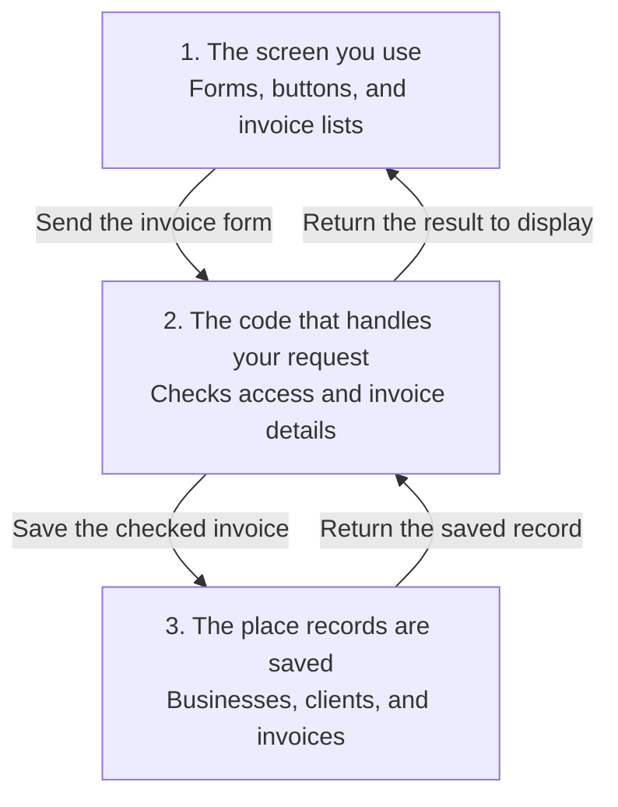
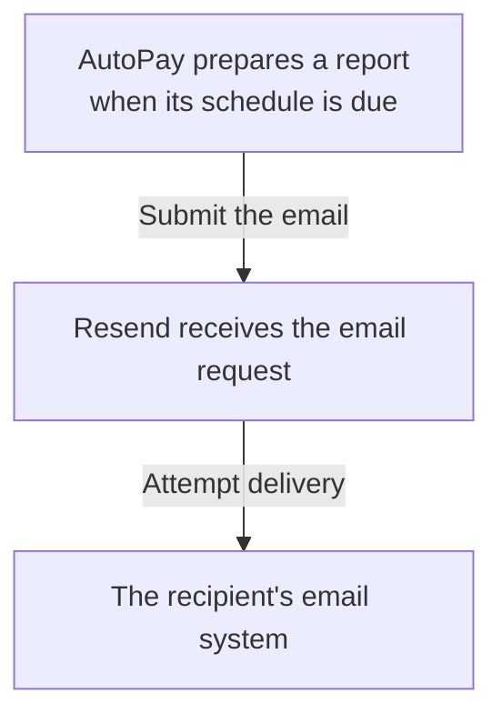

# AutoPay: architecture and code walkthrough

AutoPay is a shared invoice workspace for businesses. Team members have separate accounts but work with the same business records. The current app manages invoices, clients, attachments, payment records, email settings, and invoice summaries. It does not process real payments or place collection calls.

This guide describes the root application in this repository. The older Java application inside `AutoPay-source.zip` is a separate implementation. Start with this guide, then use [Presentation and technical questions](PRESENTATION_GUIDE.md) to rehearse and [Tools and services](TOOLS_AND_SERVICES.md) to review the stack. The [file guide](FILE_GUIDE.md) describes each source file.

## 1. What happens when you use AutoPay

Start with an action you can see: creating an invoice. You fill in a form and click Save. AutoPay checks the information, stores it, and shows the result. Three parts work together to do that.



**Read the boxes from top to bottom.** Each box is a job, not a separate screen you need to open. The arrows describe messages moving between those parts. The arrows back up explain how the result gets back to you. They do not mean that the database displays the website itself.

| Diagram box         | What it does                                                                              | Tool used in AutoPay                                                                                                             |
| ------------------- | ----------------------------------------------------------------------------------------- | -------------------------------------------------------------------------------------------------------------------------------- |
| 1. The screen       | Displays the form, remembers what you type, and sends it when you click Save.             | **React**, a library for building interactive screens. It runs in your browser.                                                  |
| 2. Request handling | Checks that you are logged in, belong to the business, and entered valid invoice details. | **Cloudflare Workers**, a service that runs AutoPay's server code. A server is the part that handles requests behind the screen. |
| 3. Saved records    | Keeps the invoice so it still exists after the page is closed.                            | **Cloudflare D1**, a database service. A database is an organized collection of saved records.                                   |

### A concrete example

Suppose you enter an invoice for two hours of work at $50 per hour.

1. **On your screen:** React displays the client, quantity, price, and Save button. The browser holds your current form entries.
2. **When you click Save:** The screen sends those entries to AutoPay's server code. This message is called a **request**.
3. **Before saving:** The server verifies your login and business access. It checks the fields and calculates $100 itself, rather than trusting the total shown in the browser.
4. **In saved storage:** D1 stores the invoice under that business.
5. **Back on your screen:** The server returns a **response**, meaning its reply. The screen reloads the list and displays the saved invoice. If a check failed, it shows an error instead.

Typing into a form is not the same as saving a record. React keeps the form usable; the server and database make the change persistent.

### Where login fits

**Supabase Auth** is the account service. It handles signup, passwords, and login sessions. After login, the browser receives a temporary **token**, which is evidence of that login. The browser sends the token with requests, and AutoPay's server asks Supabase to verify it.

A valid login answers “Who is this user?” AutoPay then checks its own saved business memberships to answer “May this user access this business?” These are separate checks. Supabase does not hold AutoPay's invoice database in this implementation.

### Where email fits

Email is a separate path. **Resend** is the service AutoPay asks to send a message when email settings are configured.



The schedule is checked by Cloudflare every 15 minutes. No one needs to keep the website open. An accepted email request is not proof that the message reached the inbox; the app records delivery attempts and can retry failures.

### The other names you will see

| Name       | What it is                                       | Why it is here                                                                                     |
| ---------- | ------------------------------------------------ | -------------------------------------------------------------------------------------------------- |
| JavaScript | A programming language.                          | Contains instructions for what the screens and server do.                                          |
| HTML       | Describes the starting webpage.                  | Gives the browser the page and a place to display AutoPay.                                         |
| CSS        | Styling rules.                                   | Controls colors, spacing, tables, and how the page fits a phone.                                   |
| SQL        | A language for working with database records.    | Asks D1 to find, add, or update invoices and other records.                                        |
| Git        | A tool that records file changes.                | Keeps a history of the project's code and documentation.                                           |
| GitHub     | A website that hosts the Git repository.         | Where you view the code and these guides. It is separate from the running AutoPay application.     |
| Vite       | A development/build tool.                        | Runs the app during development and prepares files for hosting.                                    |
| Node.js    | Runs JavaScript outside a browser.               | Runs local development tools and automated tests. The live server code runs on Cloudflare Workers. |
| npm        | A package installer and command runner.          | Installs libraries and starts commands such as tests or builds.                                    |
| Wrangler   | Cloudflare's command-line tool.                  | Publishes the app and manages its database setup and secret settings.                              |
| OpenAI     | An optional service that generates chat answers. | Not called in the default free testing mode; that mode uses rules written in the project.          |

You do not need to install or open each of these to use AutoPay. Some run the application, some help develop it, and some are optional services. The [tool guide](TOOLS_AND_SERVICES.md) separates those groups.

## 2. Terms used in the code

| Term                   | Meaning in AutoPay                                                                                          |
| ---------------------- | ----------------------------------------------------------------------------------------------------------- |
| Component              | A React function that describes part of the screen, such as an invoice form.                                |
| JSX                    | JavaScript syntax used to describe screen elements. Vite turns it into browser JavaScript.                  |
| Props                  | Values or callbacks passed into a component by its parent.                                                  |
| State                  | Values React remembers between screen updates, such as selected invoices.                                   |
| Effect                 | Code that connects a component to something outside rendering, such as a request, timer, or event listener. |
| API endpoint           | A server address for one operation, such as `/api/invoices`.                                                |
| HTTP method            | Indicates the kind of request. This app mainly uses GET for reads and POST for changes.                     |
| JSON                   | A text format for exchanging objects and arrays between browser and server.                                 |
| Async/await            | JavaScript syntax for waiting for a request or database operation without blocking all other work.          |
| Authentication         | Checking who is logged in.                                                                                  |
| Authorization          | Checking what that person may access or change.                                                             |
| Token                  | Temporary login evidence sent with a request and verified by the server. It is not the user's password.     |
| SQL                    | The language used to query and update the database.                                                         |
| Migration              | A numbered file that creates or changes database tables.                                                    |
| Binding                | A configured resource available to a Worker, such as `env.DB`.                                              |
| Idempotency            | Making a repeated operation have the effect of one operation. Used when retrying emails.                    |
| Optimistic concurrency | Saving only if the record has not changed since it was read.                                                |
| Mock                   | A controlled substitute for an outside service during a test.                                               |

## 3. How the browser starts

Opening the website starts a chain of files. The first file provides the page; the next starts React; the account screen decides whether to show login or a business workspace.

Read [index.html](../index.html), [src/main.jsx](../src/main.jsx), and [app/auth-shell.jsx](../app/auth-shell.jsx).

1. The browser loads `index.html`, including the root element and JavaScript entry.
2. `src/main.jsx` asks React to render `AuthShell` in that root element.
3. The shell requests `/api/public-config`. The response contains a public Supabase URL and publishable key, not server secrets.
4. The Supabase client handles signup, login, password recovery, and session persistence.
5. The shell calls `/api/auth/me` to get the server-verified identity, local account, and business memberships.
6. The user creates a business, joins through an invitation, or selects an existing membership. The workspace is then loaded.

The workspace uses a lazy import, so its code can load separately from the account screens. The main app is a single-page React application; the Worker serves the HTML fallback for account paths such as `/signup`.

### Reading a component

In `app/workspace/index.jsx`, `App` is a function that returns JSX. Its state includes invoices, clients, search text, selected checkboxes, filters, and the active dialog.

- `useState` holds values that affect the displayed screen.
- `useEffect` loads records and attaches timers/listeners where needed. Its cleanup removes those listeners or timers.
- `useRef` holds a value without making a change trigger a new render. The auth shell uses refs to track whether a request is still current.
- A callback such as `onSave` lets a form ask its parent to perform a save.

Updating React state causes React to calculate the new screen. It does not automatically save anything in D1. A successful server request and a subsequent state update are separate steps.

The auth shell guards against stale responses: if an older profile request finishes after a newer one, it should not replace the newer account state. This is a request-ordering problem, not a database transaction.

## 4. Follow one invoice from the form to storage

This is the Save example from the diagram, followed through the actual filenames. Each step passes information to the next; no single file does the whole job.

Read `InvoiceForm` and `App` in [app/workspace/index.jsx](../app/workspace/index.jsx), then [api.js](../app/workspace/api.js), [worker/index.mjs](../worker/index.mjs), and [service.mjs](../lib/autopay/service.mjs).

1. The form collects client details, due date, notes, and line items.
2. The browser calls `api.create(draft)`.
3. `request()` builds `POST /api/invoices`, serializes the body as JSON, and adds a bearer token, selected business, and request marker.
4. `worker/index.mjs` checks identity through `authenticatedUser()` in `worker/auth.mjs`.
5. `AutoPayService.handle()` checks the request origin for writes and calls `scope()` to verify business membership.
6. `draft()` validates fields and calls the shared `total()` calculation. The server does not trust a total supplied by the browser.
7. The service creates an invoice ID and number, saves the invoice, and handles related client/notification records according to business settings.
8. The server returns the saved result. The screen reloads records and shows success or a useful error.

Headers are inputs, not permissions. A user can edit `X-AutoPay-Business` in a crafted request. The membership query is what decides whether that business is allowed.

### Recognize these code patterns

```js
// A simplified example of a prepared query, not a new endpoint.
const query = db.prepare("SELECT * FROM invoices WHERE id=? AND owner=?");
const row = await query.bind(invoiceId, businessId).first();
```

The `?` placeholders separate data from SQL instructions. `bind()` supplies values. `await` waits for the database result. `first()` returns one row. Including `owner` prevents a valid invoice ID from being enough to access another business's record.

The current service uses direct prepared SQL, not an ORM. The `drizzle/` directory name comes from the project's history; it does not mean the current code uses Drizzle ORM at runtime.

### Errors

`ApiError` represents expected problems such as missing permissions or invalid input. `serve()` translates those into JSON responses. Unexpected failures get a general client message rather than internal details.

| Status | Example meaning                                                    |
| ------ | ------------------------------------------------------------------ |
| 400    | A required field, amount, or date is invalid.                      |
| 401    | A valid login is required.                                         |
| 403    | The user is not allowed to perform the action.                     |
| 404    | The requested record or route is unavailable.                      |
| 409    | A conflicting edit, duplicate record, or unsupported state change. |
| 413    | The request or supported assistant workspace size is too large.    |
| 429    | A configured paid-assistant limit was reached.                     |
| 503    | A required service or configuration is unavailable.                |

These statuses are conventions used by this implementation; inspect the specific route when explaining an individual error.

## 5. Accounts, businesses, and the database

Think of a database table as a structured list with rows and columns. Different tables hold different kinds of records. An ID is a unique label used to connect records, such as an invoice to its business.

Read the SQL files in [drizzle](../drizzle) and `scope()`, `owner()`, and `invoice()` in the service.

| Table/group                       | What it stores                                                    | Relationship to know                                            |
| --------------------------------- | ----------------------------------------------------------------- | --------------------------------------------------------------- |
| `accounts`                        | Local account name/email information tied to identity IDs.        | One account can have several memberships.                       |
| `businesses`                      | Business name, owner, profile, invoice email settings.            | A business has many invoices and clients.                       |
| `memberships`                     | User, business, and role.                                         | Connects multiple users to the same business.                   |
| `invites`                         | Destination email, hashed token, expiry, and use time.            | Joining requires the verified matching email.                   |
| `clients`                         | Contact/profile JSON and separate bank-storage fields.            | `owner` is a business ID.                                       |
| `invoices`                        | Searchable identity fields, invoice JSON, deletion flag, version. | `owner` is a business ID; `version` detects conflicting writes. |
| `attachments`                     | File name, size, storage key, invoice, and business.              | Access metadata is separate from stored bytes.                  |
| `file_objects`, `file_chunks`     | D1-backed file contents.                                          | An object has ordered chunks.                                   |
| `notifications`                   | New-invoice email attempts and status.                            | Separate from report email runs.                                |
| `report_schedules`, `report_runs` | Desired schedule and individual email attempts.                   | Schedule settings are not the same as delivery history.         |
| `ai_usage`                        | Paid-assistant counters.                                          | Business/hour and site/day limits use saved counters.           |
| `legacy_identity_links`           | Explicit imported-account mapping.                                | A confirmed email can claim only its prepared mapping.          |

### Why some fields are JSON

An invoice has nested line items and activity, which are convenient to store as one JSON document. Separate columns hold fields needed for IDs, uniqueness, business scope, deletion, and versions. Reports also use SQLite JSON extraction to read values inside the document.

The tradeoff is flexibility versus database-level structure. The service must validate JSON carefully, and large-scale reporting may benefit from normalized invoice/item/payment tables later. Do not claim every relationship is enforced by foreign keys; much of business scope is enforced in service queries.

### Shared data is not automatic live synchronization

Team members query the same database through their memberships. That makes the records shared. It does not mean edits are pushed instantly over WebSockets. The UI refreshes after its own actions; its periodic reload is conditional on the existing `live` state. The current Worker reports live voice capability as unavailable. Automatic cross-user push updates are not implemented.

## 6. Invoice rules and safe editing

These rules decide what counts as a valid amount, when an invoice is late, and how changes are saved without silently overwriting another request.

Read [domain.js](../app/workspace/domain.js) and `writeInvoice()` in the service.

**Money:** `$12.50` becomes 1,250 cents before arithmetic. Two items at that price total 2,500 cents, then display as `$25.00`. Decimal floating-point numbers can introduce small errors, so arithmetic uses integer cents. Validation also bounds quantities, item counts, and totals.

**Status:** `OPEN`, `PAID`, and `VOID` are stored states. `OVERDUE` is derived when an open invoice's due date is before the comparison date. A paid invoice stops aging on the recorded payment date. A void invoice has no overdue-day value.

**Dates:** Browser helpers use local calendar dates. The assistant snapshot labels its date as UTC. Reports use the configured timezone. Mention this distinction if asked about a boundary around midnight.

**Conflicting edits:** The database update includes the version originally read:

```sql
UPDATE invoices
SET data=?, number=?, deleted=?, version=version+1
WHERE id=? AND owner=? AND version=?
```

If a teammate has already changed the version, zero rows match and the server returns a conflict. This protects an update once its server-side read has happened. The browser does not send a version from when the edit form originally opened, so this is not full detection of every long-open stale form. That is a useful improvement to propose.

**Trash:** Delete marks an invoice deleted rather than permanently removing it. Ordinary listings exclude it; restore retrieves it through the authorized trash path. This supports recovery but is not a permanent erasure feature.

**Payments:** Manual payment fields record an outside payment. Neither changing status nor adding a check number proves settlement. No current Worker route transfers money.

## 7. Identity and data protection

There are two questions to check: whether the login is real, and whether that user has permission for this business or action. Protecting bank details adds another layer.

Read [worker/auth.mjs](../worker/auth.mjs), `scope()`/`owner()` in the service, and [bank.mjs](../lib/autopay/bank.mjs).

- Supabase verifies the bearer token through its user endpoint. The server requires a confirmed, non-anonymous email.
- Membership checks decide which business records the verified user may access.
- Owner checks protect restricted settings and bank operations.
- Public configuration allows publishable keys and supported legacy anon keys, but rejects private administrator keys.
- Write requests require the request marker and pass origin checks. These checks complement authentication; they do not replace it.
- SQL values are bound to prepared statements, rather than interpolated into SQL text.
- Browser security headers restrict embedding and allowed connections. They are one layer, not a guarantee against every attack.

### Bank encryption explained

`encryptBank()` generates a fresh 12-byte random IV and uses AES-GCM with a 32-byte key. The IV is saved with the encrypted result and does not need to be secret. The key must remain secret. The business and client IDs are additional authenticated data: changing that context makes decryption fail.

Encryption is reversible with the correct key because the owner needs to read the bank information later. Hashing is different: invitation tokens are hashed for lookup rather than encrypted for later recovery. Neither a valid routing checksum nor encrypted storage establishes ownership of a bank account.

This is application-layer field encryption, not end-to-end encryption: the server can decrypt authorized requests. No security audit, payment compliance certification, or guarantee of production readiness should be inferred from these checks.

## 8. Attachments and Excel exports

An attachment is a file saved with an invoice. An export is a new spreadsheet created from invoice records. Uploading an attachment and downloading a spreadsheet use different code paths.

Read [worker/database-files.mjs](../worker/database-files.mjs), `files()` in the service, and [excel.js](../app/workspace/excel.js).

**Upload:** The server checks membership, finds the invoice within the business, bounds the request, parses the file, checks file/count/total-size limits, saves bytes, and inserts the attachment listing. The insert rechecks limits to handle competing uploads; failed listing operations attempt to clean up the saved bytes.

The current limits are 5 MiB per file, 10 files and 25 MiB per invoice. D1 stores file bytes in 128 KiB pieces. Downloads stream them in sequence. R2 is an optional alternate storage binding; enabling it without moving existing bytes would leave old attachment keys unavailable.

**Export:** The browser generates an XLSX file, which is a ZIP of XML files. `excel.js` creates the XML, ZIP headers, CRC checksums, and directory. It uses text cells for user input and numeric cells for amounts. It does not use SheetJS or the Microsoft Excel API.

Checked invoices are exported when any are selected; otherwise the current filtered list is exported. Exporting does not change invoice records. Uploaded files are not virus-scanned by this implementation.

## 9. Email delivery and report scheduling

The app saves both the desired schedule and the results of individual send attempts. Keeping those separate lets it explain a failure and try again later.

Read [reports.mjs](../lib/autopay/reports.mjs), invoice notification code in the service, and the `scheduled` handler in the Worker.

A schedule says when a business wants reports. A report run is one saved attempt, with recipient, payload, status, and retry information. Keeping these separate allows settings to change without losing delivery history.

Cloudflare's configured cron runs every 15 minutes. The scheduler scans future UTC times against the chosen local timezone. A business/day ID helps avoid generating the same scheduled report twice, including when clocks move backward. Conditional updates avoid advancing a schedule that was changed while it was being processed.

Before sending, a database update reserves the run for five minutes. A second sender sees the reservation and should not send it at the same time. A stable Resend idempotency key lets retries identify the same request. Retries are bounded by existing attempt and time limits; this is not a claim of mathematically guaranteed exactly-once delivery.

The report includes current balances and counts, not just changes since the previous email. `SENT` records provider acceptance, not confirmed inbox placement or reading. Provider configuration, network failures, or quotas can prevent delivery; the delivery history exposes failures.

## 10. The two chat modes

The testing assistant recognizes questions using programmed rules. The optional OpenAI mode asks an outside AI service. The same chat window can display either, so the mode matters.

Read [testing-chat.mjs](../lib/autopay/testing-chat.mjs), [chat.mjs](../lib/autopay/chat.mjs), and the `/chat` branch in the service.

The checked-in configuration selects `testing`. It recognizes question patterns, filters supplied records, and calculates summaries. It is deterministic code, not a local language model. It cannot answer arbitrary questions or supported date ranges beyond its implemented rules.

The optional `openai` path calls the Responses API only when enabled and configured with a server secret. The server supplies a sanitized snapshot; it does not send the full database or bank details. There are no model tools for editing records. Paid mode has business/hour, site/day, conversation, and snapshot limits. Provider use may have costs; free testing mode avoids that provider request but does not make all hosting services cost-free.

Totals are calculated before detail truncation. Paid mode includes up to 200 invoice/client details, and the service rejects workspaces above its current 1,000-record limits. A detailed question may not be answerable from a truncated snapshot even when a whole-workspace total is available.

Prompt instructions and omitted data reduce risk, but generated answers can still be wrong. Compare important summaries with the underlying invoices. This is not model training, fine-tuning, vector search, or a retrieval database implementation.

## 11. Testing and deployment

A test is a repeatable check that compares a result with what should happen. A build prepares the application files. Deployment publishes those files and server code. Passing one step does not prove the others worked.

`npm test` runs Node's built-in test runner. The repository has 39 tests at the documentation baseline. They check domain calculations, business isolation, identity handling, banking, attachments, exports, chat, and scheduled email behavior. Test count can change as coverage grows.

Integration tests use SQLite in memory with the migrations applied and a small adapter that resembles D1. Outside services are mocked. These tests exercise important application behavior but do not prove real Supabase configuration, real mail delivery, browser layout, or every Cloudflare runtime detail. There is no full browser end-to-end suite in the root project.

`npm run build` bundles the browser and Worker. A passing build checks that the toolchain can produce output; it is not a substitute for tests or a successful deployment.

Deployment uses Wrangler and the bindings in `wrangler.jsonc`. Despite its extension, this project keeps that file valid as ordinary JSON because `scripts/check-deployment.mjs` reads it with `JSON.parse`; trailing commas or comments would break the setup check. Dependencies are installed with `npm ci` from the lockfile. Private values belong in server secrets or ignored local configuration. Schema changes use numbered SQL migrations. A static GitHub Pages site cannot run this Worker, access its D1 binding, or replace its backend.

## 12. Practice with the actual code

Use local test data, not real client bank details or a shared production business. Do not send test emails or change the live database just to demonstrate a concept.

| Exercise                                              | What a correct explanation includes                                                                                                                          |
| ----------------------------------------------------- | ------------------------------------------------------------------------------------------------------------------------------------------------------------ |
| Trace `api.create()` to the database.                 | Form, request headers/body, Worker identity check, membership, validation, prepared insert, response, screen reload.                                         |
| Explain `scope()` without reading the SQL aloud.      | It checks whether this logged-in user is a member of this business and records their role for later checks.                                                  |
| Walk through a rejected cross-business request.       | A token identifies the user; it does not authorize an arbitrary business. Membership or scoped record lookup rejects it.                                     |
| Calculate two items at $12.50.                        | 1,250 cents × 2 = 2,500 cents = $25.00; the server recalculates this.                                                                                        |
| Explain the invoice version check with two requests.  | Both read version 4; one saves version 5; the second update expecting 4 affects zero rows and conflicts. Also identify the stale-form limit described above. |
| Follow a file download.                               | Authenticated request, business/invoice file lookup, storage key, chunk stream, download response.                                                           |
| Explain a report send whose network response is lost. | The result is uncertain, the run remains recorded, retry uses the same provider key; acceptance is not inbox receipt.                                        |
| Explain why the free chat makes no OpenAI call.       | The testing branch returns an answer before the paid provider path. A configured key alone does not enable it.                                               |
| Locate a test for each claim.                         | Use test names and assertions, not just a green test count.                                                                                                  |

For each topic, practice three layers: a one-sentence explanation, a walkthrough of the responsible functions, and a limitation or improvement. If the second layer is unclear, read the linked function and its test before adding it to the presentation.
